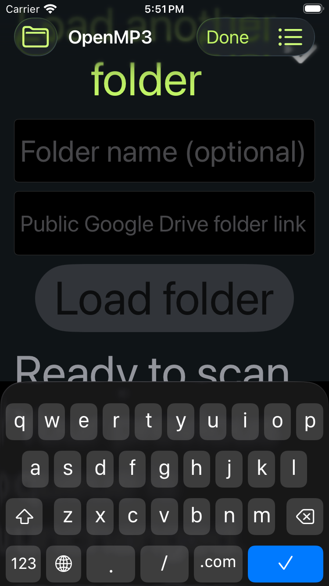
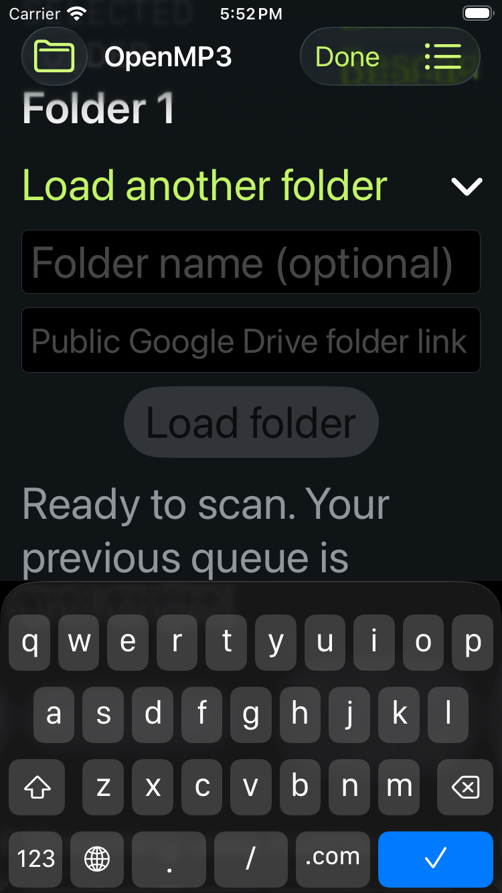

# OpenMP3 acceptance review — 2026-11-15

Reviewed PR #14 at `5733652`, including merged PR #16, against base `76af17c`.
Fetched `origin` before review. No `AGENTS.md` was present in the checkout,
PR #14 tree, or ancestor directories. Unrelated local brainstorm, glossary,
specification and ticket files were preserved and checked against their prior
hashes. No application source changed during this review.

The installed Matt Pocock `code-review` skill was followed with fresh independent
Standards and Spec reviewers. Tracker inputs were current PR #14, specification
#3, T01 #4 and keyboard Issue #15, including owner comments. This is acceptance
verification, not a new implementation phase or permission to merge PR #14.

## Local verification

| Check | Result | Scope |
| --- | --- | --- |
| `swift test` | PASS: 23 tests, zero failures | Controlled application boundary, not real network/audio proof. |
| `python3 scripts/build_simulator.py` | PASS | SwiftUI application compiled for canonical deployment target; no claim of oldest-OS runtime testing. |
| `git diff 76af17c...HEAD --check` | PASS | Reviewed implementation whitespace. |
| Enlarged text, URL focus | PASS for tested simulator states | iPhone SE (3rd generation), iOS 26.5. Used Simulator Features → Increase Preferred Text Size repeatedly (11 increments from normal), then checked a second enlarged setting three decreases below it. Exact OS content-size category was not read. In both enlarged settings, focusing URL brought it above the software keyboard with Load and Done reachable. |
| Enlarged text, optional name / Next / Done | PASS | At the largest tested setting the focused name remained visible; Next focused the visible URL; navigation Done dismissed the keyboard. Load was partly below the keyboard when name was focused, but dismissal made it reachable. |
| Enlarged text after cold launch | PASS for tested state | Rebuilt/reinstalled the same source and relaunched. Saved root remained selected; state was IDLE with no queue. Opening folder entry and focusing URL again kept it visible. |
| Changing text size during editing | LIMITATION FOUND | When URL is already focused, changing preferred text size can leave it off-screen. Done → refocus recovers it. The scroll callbacks observe focus and keyboard presentation, not text-size changes. This narrower follow-up does not reproduce the original focus-entry blocker. |
| Entire player accessibility | PARTIAL | At extreme size the player requires substantial scrolling, labels wrap and the two-line title truncates. No complete all-controls accessibility pass is claimed. |
| VoiceOver / physical large-text behavior | UNVERIFIED | Accessibility-tree labels and simulator layout checks are not spoken focus-order or physical-device evidence. |

Normal text size was restored on the test simulator. No physical phone settings
were changed and no audio was started during this pass. These screenshots show
empty input fields and no personal music metadata:

| Largest tested text setting | Second enlarged text setting |
| --- | --- |
|  |  |

## Standards

No required Standards fixes or documented-standard violations found. The code
respects the no-key architecture, canonical platform/scan configuration, local
saved-root persistence, and selected-root/queue-source terminology.

One optional Duplicated Code judgment call: `PlayerScreen.swift` repeats the
animated centered scroll in the focus-change and keyboard-show callbacks. A shared
helper could consolidate that policy if it changes; both event triggers remain
necessary. This is not a merge blocker.

## Spec

Two partial-requirement findings remain:

1. **T01:** real pagination, real resource-key handling, representative large
   non-audio-heavy and negative fixtures, completeness reconciliation, and final
   measured scan-work budgets remain unresolved. Native seek/end/second-item
   events and general audible output are already recorded, but distinct audible
   seek and second-track confirmation are partial. Numerical recommendations
   remain only in the canonical brainstorm scan-limits section. The existing
   small/deeper fixtures cannot prove the missing cases merely by rerunning them.
2. **PR #14:** integrated physical audio, navigation, lock-screen, interruption,
   route-change and remote-control acceptance remains incomplete. VoiceOver,
   full accessibility coverage and legacy runtime/hardware remain unverified.

No scope creep or further reproducible playback-code defect was established by
the independent review. The subsequent local text-size-change limitation above is
a nonblocking follow-up for the keyboard ticket; broader accessibility acceptance
remains partial. No new access method, completeness claim, or budget approval is
justified by this review.

## Issue #15 recommendation

**Recommend closure of #15; no issue was closed here.** Its core “Done” criterion
is visible URL entry/paste and loading on the physical iPhone. The
[owner's confirmation](https://github.com/eugenelin89/OpenMP3/pull/16#issuecomment-6903960079)
establishes keyboard visibility, long-press Paste, Done → Load without autoplay,
and uninterrupted music while reopening the form. Those checks remain valid:
there have been no subsequent implementation changes. PR #16 is reviewed and
merged into PR #14's branch. Existing simulator evidence covers name, feedback,
fresh/returning state and keyboard reopen; this pass adds enlarged-text checks.

The issue requests accessibility sizes/VoiceOver **“as practical”**, rather than
making complete VoiceOver validation its mandatory physical-keyboard completion
condition. Keep the unverified VoiceOver coverage and live text-size-change
limitation visible in broader acceptance. Closing the narrow keyboard issue would
not clear T01, accept the whole player, or authorize merging PR #14.

## Remaining manual checks, in order

Record device/OS, audio route and result per step; record Maps version for step 2.
Do not repeat the already-confirmed ordinary keyboard/Paste/Load/form-opening
checks. This checklist covers different, still-unverified behavior.

1. **Audible seek and progression (iPhone):** Use an authorized collection with
   at least two distinct tracks. Play, move the seek slider to the middle, and
   listen for continuation there. Seek near the end and wait without pressing
   Next. Expected: audible continuation after seek, then the next distinct track
   starts naturally. Check manual Next/Previous separately; when paused, those
   commands must not resume playback.
2. **Background navigation and lock (iPhone):** While stationary or as a
   passenger, play music, foreground Maps and obtain a spoken navigation prompt.
   Expected: music ducks/briefly interrupts and recovers appropriately. Lock the
   phone through a track boundary, then return to OpenMP3. Expected: audible next
   track, consistent current-track/position/queue state.
3. **Remotes, interruption and route (iPhone + available headset):** Exercise
   lock-screen and supported headset play/pause, Next and Previous. Disconnect
   while playing, then reconnect. Expected: disconnect pauses; reconnect alone
   does not play. Explicitly pause before a Maps prompt/system interruption;
   expected: it remains paused afterward. Test shuffle/repeat end behavior as
   needed during this listening session; controlled tests already cover the rules.
4. **Browsing mutations during audio (iPhone):** While root A plays, select/scan
   root B, Stop scan, then Rescan B; remove saved A while its queue still plays.
   Expected: browsing results/status change but A's queue source and music remain
   intact. This extends beyond the confirmed check of merely opening the form.
5. **VoiceOver (iPhone, optional larger text):** Enable Settings → Accessibility
   → VoiceOver, then swipe through folder entry, Load/Done, transport/seek,
   shuffle/repeat, saved folders and queue. Double-tap intended controls.
   Expected: meaningful labels/values, logical focus order, all controls reachable
   and operable. Test enlarged text if practical; restore the user's settings
   afterward. Spoken behavior must not be inferred from simulator AX labels.
6. **T01 fixture preparation (owner/data task, not a phone test):** Supply an
   authorized test tree plus an independent expected-count/path manifest. Include
   a genuinely multi-page/non-audio-heavy folder, same filenames with distinct
   IDs, shortcuts, an inaccessible descendant, and real resource-key-protected or
   download-restricted cases where available. Keep links/metadata private.
   Expected next experiment: anonymous discoveries reconciled with the manifest,
   unsupported/restricted access honestly reported, and listing/time/retry
   measurements sufficient to accept or reject the proposed budgets. Do not
   manufacture quota exhaustion or add another access method.

If legacy hardware is available, separately run install/launch/load/play and the
background scenario on the canonical reference device; otherwise keep it
unverified. Missing fixtures and unsupported anonymous access require evidence or
a product decision, not repeated ordinary listening tests.

**Review totals:** Standards: zero violations, one optional smell. Spec: two
partial-requirement findings; largest outstanding areas are T01 feasibility and
physical integrated-player acceptance. One local accessibility edge case recorded.
PR #14 and all acceptance gates remain open.
