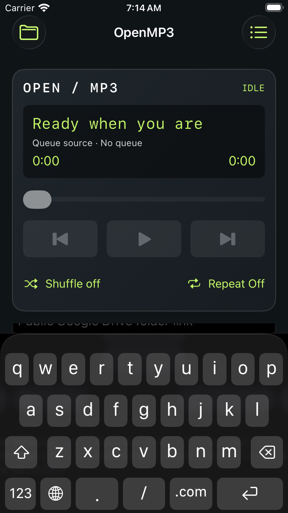
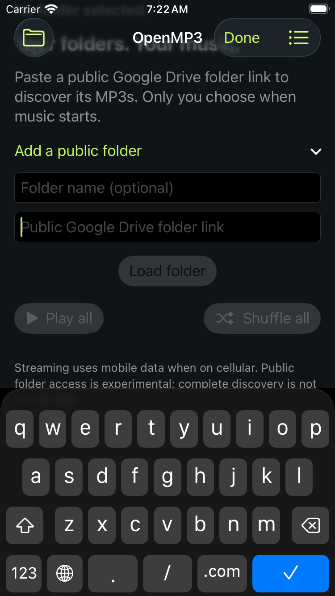

# Issue #15: keyboard-safe folder entry

Date: 2026-11-15. Base: PR #14, `0555831`. Status: simulator regression fixed;
physical-iPhone acceptance remains **unverified**.

## Reproduction and cause

Before editing, reproduced the obstruction in the existing returning-user iPhone
16 simulator and a fresh iPhone SE (3rd generation) simulator, iOS 26.5. With the
software keyboard open on the SE, only a thin sliver of the URL field remained
visible and Load was hidden. The normal-text layout kept the large player outside
the collection's scroll view, leaving too little height for the form. It also had
no explicit focus scrolling or keyboard dismissal control.

| Before (unmodified PR #14) | After (final fix) |
| --- | --- |
|  |  |

Both captures show the fresh, empty SE form and contain no personal folder data.

## Change

Use one scroll view for player and collection at every text size. Focus changes
and the keyboard's did-show notification scroll the active field into view.
The name field's Next key focuses the URL; the URL's Done key and a visible
navigation-bar Done button dismiss editing. Load dismisses editing before the
existing validation/scan action. Focus and draft values remain local to the view.
The code uses APIs compatible with the canonical minimum iOS baseline; no new
dependency or access method is introduced.

## Verification

| Check | Result and evidence |
| --- | --- |
| Fresh small viewport, software keyboard | **PASS (simulator):** SE name, URL, and Load remain visible; see after capture. |
| Standard long-press Paste | **PASS (simulator):** copied a synthetic full-length Drive URL with a resource-key query using iOS Select All/Cut, then long-pressed the empty visible URL field and chose Paste with the software keyboard open. Full value appeared and Load enabled. Synthetic URL was not submitted. |
| Optional name and keyboard Next | **PASS (simulator):** typed a name, reopened the software keyboard, and used Next to focus the visible URL field. |
| Done and reopen | **PASS (simulator):** keyboard Done dismisses; final navigation-bar Done dismisses; tapping URL reopens the keyboard with the field visible. |
| Invalid input feedback | **PASS (simulator, final build):** submitting invalid text dismissed the keyboard and displayed “Invalid Google Drive folder link”. |
| Public URL submission, no autoplay | **PASS (simulator, final build):** entered the previously authorized public fixture URL and loaded it; 14 tracks discovered, correctly marked incomplete. Player remained idle with no queue. Personal URL and track metadata omitted. |
| Returning-user form | **PASS (simulator, final build):** after loading the fixture, opened Load another folder and focused URL; name, URL, Load and Done remained visible above the software keyboard. |
| Queue independent of browsing | **PASS (automated core boundary):** existing tests verify scanning another root retains the active queue source and playback progression. UI edits only change local draft/focus state. Live physical playback while editing was **not tested**. |
| Automated suite | **PASS:** `swift test`, 23 tests, zero failures. Includes invalid-link parsing, no autoplay, queue separation, saved-root restoration, and player behavior. Run before the final UI-only relocation of Done from keyboard toolbar to navigation bar; both final builds below compile that relocation. |
| Final simulator build | **PASS:** `python3 scripts/build_simulator.py`; installed and exercised on SE simulator. |
| Final signed device build/install | **PASS:** `scripts/build_device_probe.py` with the existing local signing configuration; `devicectl` confirmed installation on the paired iPhone 16. |
| Physical iPhone software keyboard, typing and Paste | **UNVERIFIED:** iPhone Mirroring reported “iPhone in Use. Lock your iPhone to connect.” Installation is not evidence of keyboard behavior. Owner confirmation is required. |
| Accessibility text sizes and VoiceOver | **NOT TESTED in this pass.** Unified scroll layout preserves the prior accessibility layout structure; this is an implementation observation, not a runtime pass. |
| Oldest supported iOS runtime | **NOT TESTED:** compilation uses the canonical deployment target, but available simulator runtime was iOS 26.5. |

The visual regression was checked in the actual SwiftUI UI rather than adding a
unit test that merely mirrors view modifiers. Paste/name checks were performed on
the same scrolling/focus implementation before the final Done-button relocation;
the final button and keyboard reopen were then rechecked.

## Remaining acceptance

Keep #15 open until the owner can visibly type/paste a full public folder URL and
load it using the physical iPhone software keyboard. Also check opening the form
during playback and accessibility sizes/VoiceOver when practical. This patch does
not resolve or relax T01's outstanding feasibility evidence or scan-work budgets.
